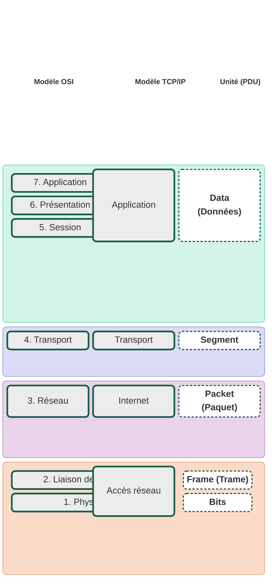
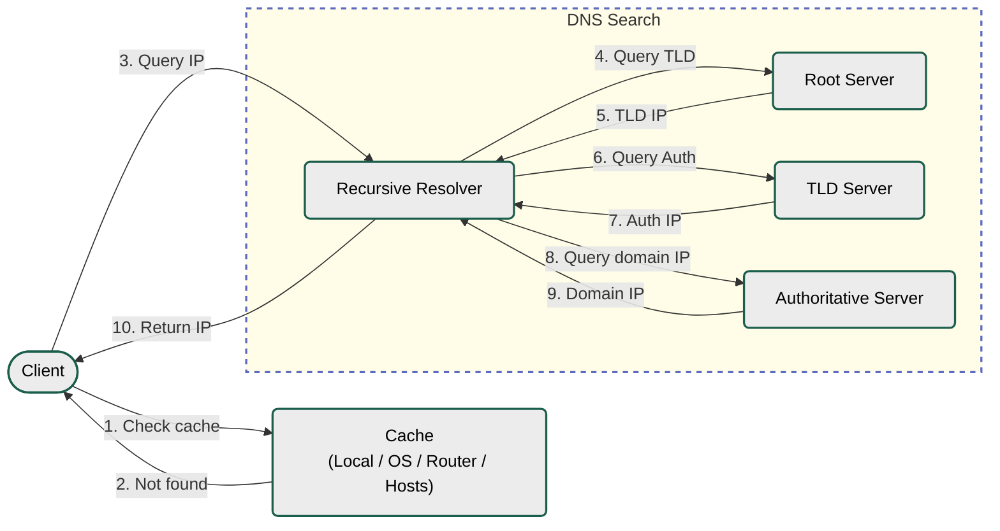

# Molakhas
## Cours
### Modele OSI et TCP/IP

### Architecture
#### Client/serveur
- 3andek serveur ou client yethadro, client ydemandi swala7 ou serveur yjaweb
##### Types
- **Architecture 2-tiers:** client serveur bark kayen ghir *(2 niveau)*
- **Architecture 3-tiers:** client et 2 serveurs *(3 niveau)*
- **Architecture n-tiers:** client ou  n-1 serveurs 
##### Avantage et Incoveniant
- Jay centralisé mala sahel fel gestion ou bech tsecurisih 
- jay centralise mala ida yetmolasta serveur yetmolasta kolch **(single point of failure)**
- tesralah constipation ki ykon ghachi bzaf **(moodle lila 9bel examen)**
#### Peer To Peer 
- Ga3 les pairs ykono clients et serveurs f nafs wa9t
##### Avantage et Incoveniant
- Jay mchi centralisé mala s3ib fel gestion ou bech tsecurisih 
- jay mchi centralise mala yetmolasta pair normal
- Kayen repartition ta3 la charge matesraloch constipation
- Performance 3la 7sab les pairs
#### Publisher/Subscriber 
- **Publisher:** Walter White yeproduisi zaza
- **Broker:** Gustave yerproposi abonnement ta3 zaza
- **Subscriber:** Yahia yconsomi zaza
Les information yet9asmo en topics par example zaza,cocaine,marijuana ou subscribers ykhayro 3la chah y2aboniw mala ki tji information jdida broker yerselhalhom direct

##### Avantage et Incoveniant
- Kayen decouplage, Pub masam3ch bel Sub
- Communication asynchrone
- S3ib fel gestion ou bech tsecurisih 
- L'information pas forcément towsal dans l'ordre
## DNS

### Fonctionement
#### Concept
- Nom de domaine yrodah adresse IP
#### el mosabi3on
- **Client:** hada li ydir la requete recursive lel resolver
- **Recursive resolver:** hada ysa9si lokhrin bah yejbed el ip bech yerselha lel client
- **Root Server:** hada ypointi lel top level domain (.dz, .com, .fr)
- **TLD Server:** hada ypointi lel serveur authoritaire 
- **Authoritative Server:** hada 3ando ma3loma final
#### Cache
- Ida ma3loma kayen fel cache **SKIP**
- TTL decidi ch7al yeb9a fel cache
#### Diagramme

#### La zone
- hna win kayen les enregistrements DNS

| **Type** | **Fonction**                            |
| -------- | --------------------------------------- |
| A        | Nom → adresse IPv4                      |
| AAAA     | Nom → adresse IPv6                      |
| CNAME    | Alias d’un nom                          |
| MX       | Serveur de messagerie                   |
| NS       | Serveur DNS autoritaire                 |
| TXT      | Informations textuelles                 |
| SOA      | Informations administratives de la zone |
| PTR      | Adresse IP → nom                        |
#### Reverse DNS
- Evil Twin DNS yrodlek adresse IP ila ism
### Ma3lomat lazem ta3rafhom

| **Port**                 | 53                                                                                  |
| ------------------------ | ----------------------------------------------------------------------------------- |
| **Protocol Transport**   | UDP mais sa3at TCP ida la reponse tfout 500 octet  wela kayen changement de zone |
| **Resolution recursive** | mabin client ou resolver                                                            |
| **Resolution iterative** | mabin resolver ou les serveurs                                                      |
| **DoT**                  | DNS over TLS port tcp 853                                                           |
| **DoH**                  | DNS over HTTPS port tcp 443                                                         |
| **DNSSEC**               | khati chiffrement ydir authentification ou integrity                                |
### Security
- **DNS vergiftung(DNS cache poisoning):** attaquant yseba3 fel cache
- **подмена DNS (DNS Spoofing):** wa7ed yjaweb fi blacet resolveur wela serveur
- DNS mchi chiffré 3la hadik kayen DoT, DoH ou may2asurich integrité mala kayen DNSSEC
- **DOS wela DDOS** 3la serveur li ma3labalehch cha ma3netha DDOS aymen gal teb3at wladek ymolestiw server, ana golt ta9ra M1 ida mata3rafch 9is ro7ak
- **DNS tunneling** testa3mel DNS bech tfout 3la firewall
- **Détournement de domaine** yedo el compte ta3 admin ou yereslok schadlicher server

| **Problème**            | **Propriété principalement concernée** | **Conséquence**                              |
| ----------------------- | -------------------------------------- | -------------------------------------------- |
| DNS Spoofing            | Authenticité                           | Fausse réponse DNS                           |
| Cache Poisoning         | Intégrité                              | Cache contenant de fausses données           |
| Requêtes non chiffrées  | Confidentialité                        | Observation des noms consultés               |
| DoS / DDoS              | Disponibilité                          | Service DNS inaccessible                     |
| Tunneling DNS           | Surveillance et contrôle du réseau     | Communication ou fuite de données dissimulée |
| Détournement de domaine | Intégrité et contrôle administratif    | Modification des enregistrements             |
# DHCP
### Fonctionement
#### Concept

# Fichiers Utiles
- [[RAV1_COURS1_RSID.pdf|Cours]]
- [[RAV1_DNS_RSID.pdf|DNS]]
- [[RAV1_DHCP_RSID.pdf|DHCP]]
- [[RAV1_HTTP_RSID.pdf|HTTP]]
- [[RAV1_IOT_RSID.pdf|IOT]]
- [[RAV1_MAIL_RSID.pdf|Mail]]
- [[RAV1_VOIP_RSID.pdf|VoIP]]
- [[RAV1_FTP_RSID.pdf|FTP]]
- [[RAV1_COURS1_Question_RSID|Questions]]